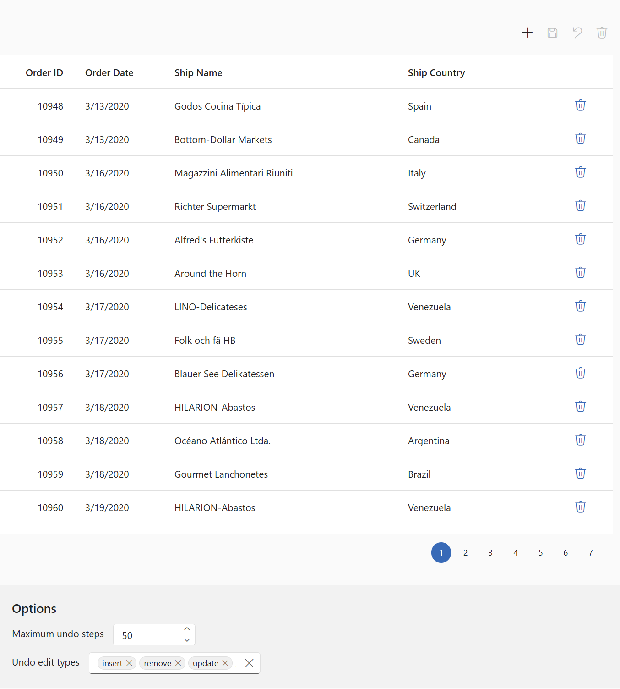

<!-- default badges list -->

[](https://supportcenter.devexpress.com/ticket/details/T1129779)
[](https://docs.devexpress.com/GeneralInformation/403183)
[](#does-this-example-address-your-development-requirementsobjectives)
<!-- default badges end -->
# DevExtreme DataGrid - Cancel Changes Sequentially

The DevExtreme [DataGrid](https://js.devexpress.com/jQuery/Documentation/Guide/UI_Components/DataGrid/Overview/) accumulates unsaved changes in the [batch edit mode](https://js.devexpress.com/jQuery/Documentation/Guide/UI_Components/DataGrid/Editing/#User_Interaction/Batch_Mode). The built-in **Discard changes** button cancels all pending changes at once. This example implements a custom undo algorithm that discards changes sequentially (one by one). To revert edits, users can click a custom button in the DataGrid toolbar or press <kbd>Ctrl</kbd>+<kbd>Z</kbd>.



The example saves user edits as steps in change history. The **Options** panel below the DataGrid allows you to adjust the following settings:

- **Maximum undo steps**: Specifies the maximum number of steps in history (default: 50). When history exceeds this limit, the example removes the oldest steps.
- **Undo edit types**: Specifies change types that users can undo (`insert`, `remove`, and `update`). When you remove a type, the example removes all steps of this type from history. When you add a type, the DataGrid discards all pending changes.

## Implementation Details

Code snippets in this section illustrate the jQuery implementation.

The `EditHistoryHelper` class implements undo operations. This class compares consecutive states of the [`editing.changes`](https://js.devexpress.com/jQuery/Documentation/ApiReference/UI_Components/dxDataGrid/Configuration/editing/#changes) array and saves previous row states.

The React project implements the same idea in the `useEditHistory` hook. This hook returns a `changes` array and an `onChangesChange` handler. Assign each value to the `Editing` component property of the same name.

### Track Pending Changes

Set the [`editing.mode`](https://js.devexpress.com/jQuery/Documentation/ApiReference/UI_Components/dxDataGrid/Configuration/editing/#mode) property to `batch`. This mode allows users to edit multiple rows before they save changes. The DataGrid stores pending changes in the `editing.changes` array.

Implement an [`onOptionChanged`](https://js.devexpress.com/jQuery/Documentation/ApiReference/UI_Components/dxDataGrid/Configuration/#onOptionChanged) handler to detect changes in this array. Pass the new array to the [`recordChanges`](jQuery/src/editHistoryHelper.js#L36-L70) helper method. This method compares the new array with the previous array to find modified rows. For each modified row, the method does one of the following:

- If users can undo this change type, the method adds a step to history. Each step stores the row key, change type, and previous row state.
- If users cannot undo this change type, the method removes all steps for this row from history. This deletion ensures that undo operations cannot revert the new change indirectly (for example, restore a deleted row).

When the `onOptionChanged` handler receives an empty `editing.changes` array (for example, when a user discards changes), the handler clears the change history. The DataGrid [`onSaved`](https://js.devexpress.com/jQuery/Documentation/ApiReference/UI_Components/dxDataGrid/Configuration/#onSaved) handler also clears the change history:

```js
onOptionChanged(e) {
  if (e.fullName === 'editing.changes'
    && Array.isArray(e.value)
    && !changeHistoryHelper.isUndoInProgress()) {
    if (e.value.length === 0) {
      changeHistoryHelper.resetHistory();
    } else {
      changeHistoryHelper.recordChanges(e.value);
    }
  }
},
onSaved() {
  changeHistoryHelper.resetHistory();
},
```

### Undo the Last Change

The `undoLastChange` method removes the most recent step from history and restores the previous row state in the `editing.changes` array. If the row had no pending changes before this step, the method removes the row entry from `editing.changes`:

```js
undoLastChange(grid) {
  const step = this.changesHistory.pop();
  if (!step) return;

  const changes = this.cloneChanges(grid.option('editing.changes'));
  const index = changes.findIndex((change) => this.getChangeKey(change) === step.key);
  if (index >= 0) changes.splice(index, 1);
  if (step.before) changes.splice(index >= 0 ? index : changes.length, 0, step.before);

  this.isUndoing = true;
  try {
    grid.option('editing.changes', changes);
    this.previousChanges = this.cloneChanges(changes);
  } finally {
    this.isUndoing = false;
    this.onHistoryChanged(this.changesHistory.length);
  }
}
```

When `undoLastChange` updates the `editing.changes` array, the DataGrid calls the `onOptionChanged` handler again. The method sets the `isUndoing` flag during this update. The handler calls the `isUndoInProgress` method to check this flag and does not save the update as a new step.

### Add an Undo Button

Add a custom undo button to the DataGrid [`toolbar`](https://js.devexpress.com/jQuery/Documentation/ApiReference/UI_Components/dxDataGrid/Configuration/toolbar/) and call the `undoLastChange` method in the button `onClick` handler.

Pass an `onHistoryChanged` callback to the `EditHistoryHelper` constructor. The helper calls this callback each time history changes (for example, after an edit or undo operation). The callback disables the undo button if history is empty and enables the button otherwise. The button `onInitialized` handler saves the button instance used in the callback:

```js
const changeHistoryHelper = new EditHistoryHelper({
  // ...
  onHistoryChanged: (historyLength) => {
    updateControlsState(historyLength);
  },
});

function updateControlsState(historyLength) {
  if (undoButton) {
    undoButton.option('disabled', historyLength === 0);
  }
}
```

Assign the `revert` icon to the undo button. To distinguish this button from the predefined **Discard changes** (`revertButton`) item, customize this predefined item to use the `trash` icon:

```js
toolbar: {
  items: [
    'addRowButton',
    'saveButton',
    {
      widget: 'dxButton',
      location: 'after',
      options: {
        icon: 'revert',
        hint: 'Undo the last change',
        elementAttr: { 'aria-label': 'Undo the last change' },
        disabled: changeHistoryHelper.getHistoryLength() === 0,
        onInitialized(args) {
          undoButton = args.component;
        },
        onClick() {
          changeHistoryHelper.undoLastChange(grid);
        },
      },
    },
    {
      name: 'revertButton',
      options: { icon: 'trash' },
    },
  ],
},
```

### Add an Undo Keyboard Shortcut

Configure a document-level [`keydown` handler](jQuery/src/index.js#L36-L43) to call `undoLastChange` when a user presses <kbd>Ctrl</kbd>+<kbd>Z</kbd>:

```js
function handleUndoKeyDown(event) {
  if (changeHistoryHelper.getHistoryLength() > 0
    && event.ctrlKey && !event.shiftKey && !event.altKey
    && event.key?.toLowerCase() === 'z') {
    event.preventDefault();
    changeHistoryHelper.undoLastChange(grid);
  }
}

document.addEventListener('keydown', handleUndoKeyDown, true);
```

### Configure Undo Settings

Pass `maxUndoSteps` and `undoTypes` options to the `EditHistoryHelper` constructor to specify initial settings. Editors in the **Options** panel call the following helper methods to apply new values:

- `setMaxUndoSteps`: Sets the maximum number of steps in history. If history exceeds the new limit, the method removes the oldest steps.
- `setUndoTypes`: Sets change types that users can undo and removes steps of other types from history.

When a user adds a change type, this example also calls the DataGrid [`cancelEditData()`](https://js.devexpress.com/jQuery/Documentation/ApiReference/UI_Components/dxDataGrid/Methods/#cancelEditData) method to discard all pending changes. This call ensures that the application skips or restores edits of each type consistently.

## Files to Review

- **Angular**
    - [app.component.html](Angular/src/app/app.component.html)
    - [app.component.ts](Angular/src/app/app.component.ts)
    - [edit-history-helper.ts](Angular/src/app/edit-history-helper.ts)
- **React**
    - [App.tsx](React/src/App.tsx)
    - [edit-history-helper.ts](React/src/edit-history-helper.ts)
- **Vue**
    - [HomeContent.vue](Vue/src/components/HomeContent.vue)
    - [edit-history-helper.ts](Vue/src/edit-history-helper.ts)
- **jQuery**
    - [index.html](jQuery/src/index.html)
    - [index.js](jQuery/src/index.js)
    - [editHistoryHelper.js](jQuery/src/editHistoryHelper.js)
- **ASP.NET Core**
    - [Index.cshtml](ASP.NET%20Core/Views/Home/Index.cshtml)
    - [editHistoryHelper.js](ASP.NET%20Core/wwwroot/js/editHistoryHelper.js)
    - [DataGridWebApiController.cs](ASP.NET%20Core/Controllers/DataGridWebApiController.cs)

## Documentation

- [DataGrid - Batch Edit Mode](https://js.devexpress.com/jQuery/Documentation/Guide/UI_Components/DataGrid/Editing/#User_Interaction/Batch_Mode)
- [editing.changes](https://js.devexpress.com/jQuery/Documentation/ApiReference/UI_Components/dxDataGrid/Configuration/editing/#changes)
- [toolbar](https://js.devexpress.com/jQuery/Documentation/ApiReference/UI_Components/dxDataGrid/Configuration/toolbar/)
- [cancelEditData()](https://js.devexpress.com/jQuery/Documentation/ApiReference/UI_Components/dxDataGrid/Methods/#cancelEditData)

## More Examples

- [DataGrid - Batch Editing Demo](https://js.devexpress.com/jQuery/Demos/WidgetsGallery/Demo/DataGrid/BatchEditing/)
<!-- feedback -->
## Does This Example Address Your Development Requirements/Objectives?

[](https://www.devexpress.com/support/examples/survey.xml?utm_source=github&utm_campaign=devextreme-examples-template&~~~was_helpful=yes) [](https://www.devexpress.com/support/examples/survey.xml?utm_source=github&utm_campaign=devextreme-examples-template&~~~was_helpful=no)

(you will be redirected to DevExpress.com to submit your response)
<!-- feedback end -->
